<div align="center">

# PACE
### Predictive Pedal Misuse Prevention & Driver Behavior Correction

**페달 오조작 예방을 위한 선제적 위험 인지 및 다중감각 기반 운전자 행동 교정 시스템**

**제24회 임베디드SW경진대회 · 자동차/모빌리티 부문**  
한국공학대학교 | Team PACE

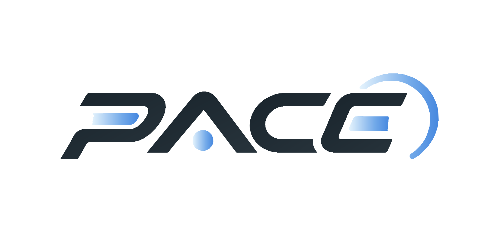

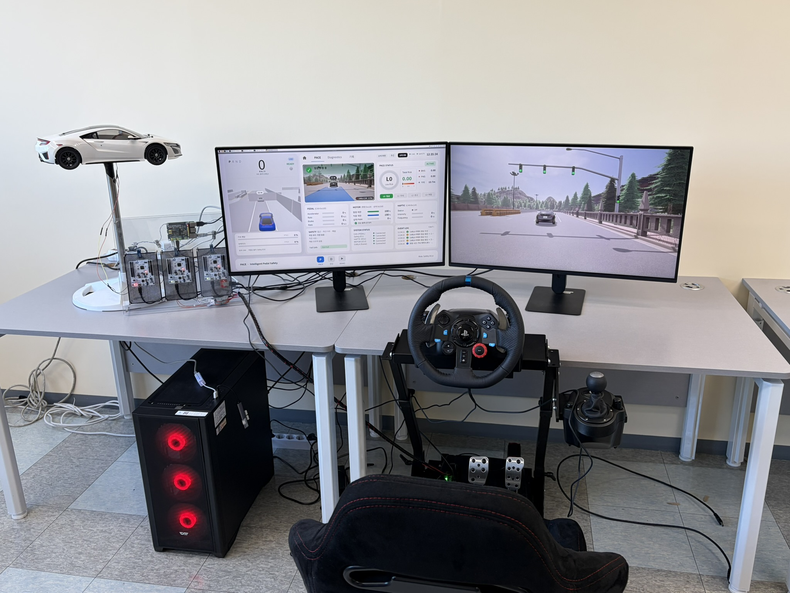

[](https://www.youtube.com/watch?v=Ao3brh2CypE)


</div>

---

## 1. 프로젝트 소개

PACE는 **주행 환경과 페달 조작 정보를 실시간으로 분석해 페달 오조작 위험을 조기에 판단하고, 촉각·시각·청각 피드백으로 운전자가 스스로 조작을 교정하도록 유도하는 선제적 안전 보조 시스템**입니다.

위험 발생 시 즉시 구동력을 제한하는 방식에만 의존하지 않고, **위험 인지 → 단계별 경고 → 운전자 행동 교정 → 필요 시 차량 개입** 순서로 동작합니다.

- **위험 판단:** 전방 거리·TTC 기반 BNS와 페달 입력량·입력 변화율 기반 PMS
- **다중감각 경고:** SIMAGIC P-HPR 햅틱 페달, 3D HMI, 경고음
- **차량 제어:** Level 2 오조작 의심 시 최고 속도 30 km/h 제한, Level 3 구동 출력 차단
- **분산 제어:** Raspberry Pi 5 + STM32 ×3, Classical CAN 500 kbps
- **검증:** CARLA 가상 주행, CANoe 실제 버스 분석 및 고장 주입 시험

> 이 프로젝트는 연구·시연용 프로토타입이며, 양산 차량용 안전 인증 시스템이 아닙니다.

## 2. 주요 성과

개발완료보고서 기준, **23명의 참가자가 3개 위험 시나리오를 PACE 미적용/적용 조건에서 각각 345회씩, 총 690회** 수행했습니다.

| 평가 항목 | PACE 미적용 | PACE 적용 | 개선 효과 |
|:--|--:|--:|--:|
| 평균 페달 교정 반응시간 | 1.46초 | 1.08초 | **26.0% 단축** |
| 행동 교정 성공률 | 60.0% (207/345) | 80.0% (276/345) | **20.0%p 향상** |
| 충돌 발생률 | 20.0% (69/345) | 9.6% (33/345) | **52.2% 감소** |

시험 시나리오: **일반 주행 중 선행차 감속 / 야간 돌발 장애물 등장 / 교차로 측면 차량 진입**

**검증 범위:** 위 성과는 CARLA 기반 주행 시나리오와 연구용 시연 환경에서 측정한 결과로, 실제 도로에서 동일한 효과를 보장하지 않습니다.

### 통신·고장 대응 검증

- **CAN 버스 부하율 평균 12.26%** (VN5620 실제 버스 측정)
- **CAN Error Frame 0건** (클럭 설정 개선 후 재검증 결과)
- **정상 3종 + 고장 15종 = 총 18개 시나리오 검증**
- 고장 15종에 대해 **안전 정지 10종 / 주행 유지 및 햅틱 차단 5종**으로 분류하여 대응

## 3. 시스템 구성

### 전체 시스템 아키텍처

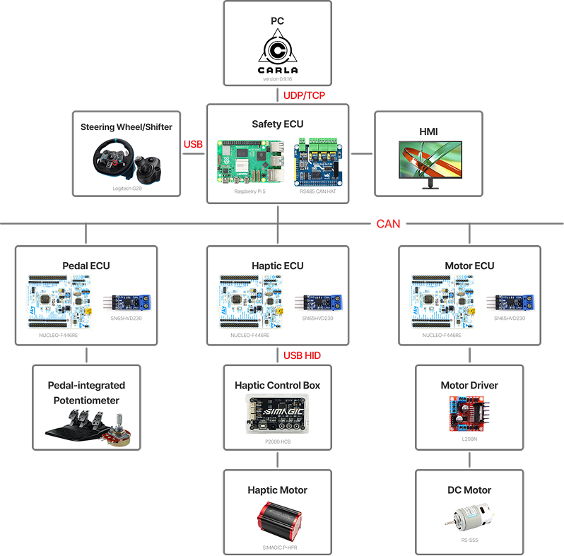

PC의 CARLA 시뮬레이터와 Safety ECU(Raspberry Pi 5)는 Ethernet/UDP로 연동되며, Safety ECU와 Pedal·Haptic·Motor ECU(STM32)는 CAN으로 데이터를 교환합니다. Haptic ECU는 USB HID로 햅틱 컨트롤러를 제어합니다.

### 통합 시연 장비

| 측면에서 본 시연 환경 | HMI 및 주행 화면 |
|:--:|:--:|
| 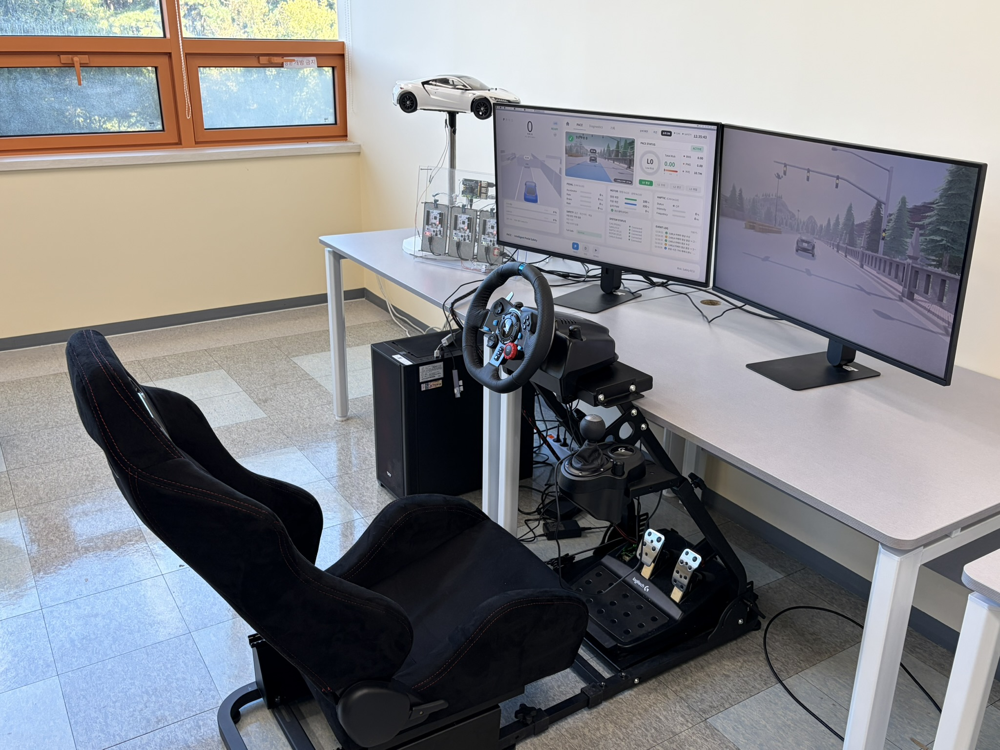 | 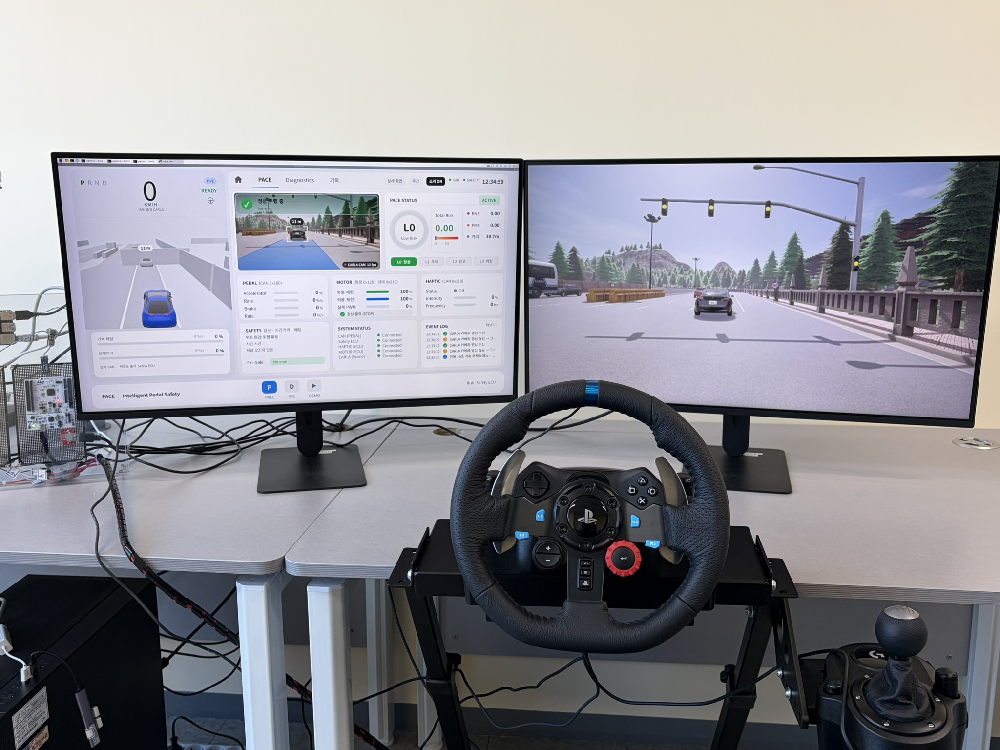 |

### CAN 기반 ECU 구성

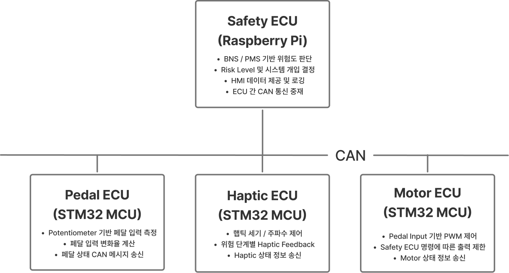


PACE는 센서·페달·시뮬레이션 입력을 Safety ECU로 통합하고, 판단 결과를 CAN으로 Haptic ECU와 Motor ECU에 전달합니다.

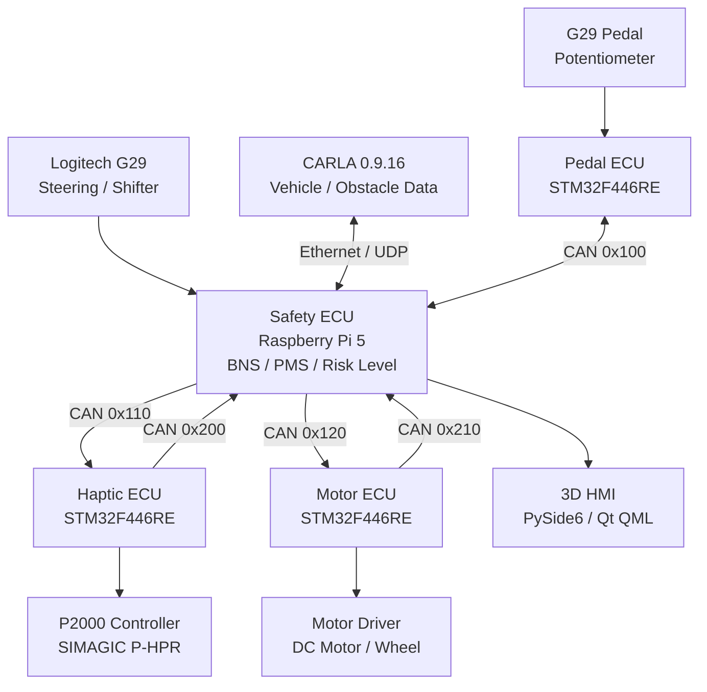

| ECU | 하드웨어 | 주요 역할 |
|---|---|---|
| **Safety ECU** | Raspberry Pi 5 | 입력 통합, BNS/PMS 계산, 위험 등급 및 제어 명령, 통신 상태 감시 |
| **Pedal ECU** | STM32 NUCLEO-F446RE | ADC 기반 페달 입력량·변화율 측정, CAN 송신 |
| **Haptic ECU** | STM32 NUCLEO-F446RE | 위험 단계에 따른 햅틱 세기·주파수 제어 |
| **Motor ECU** | STM32 NUCLEO-F446RE | PWM 기반 모터 구동, 출력 제한·차단, Fail-Safe |
| **3D HMI** | PySide6 / Qt QML | 주행 정보, 위험 지표, 개입·고장 상태 표시 |

### 실제 하드웨어

| 페달 및 햅틱 액추에이터 | 분산 ECU 하드웨어 |
|:--:|:--:|
| 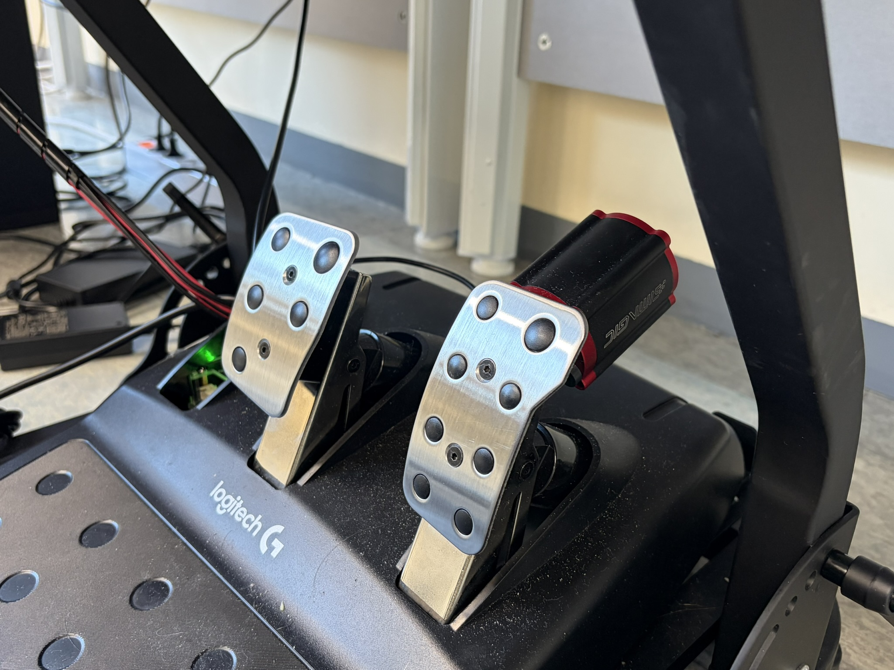 | 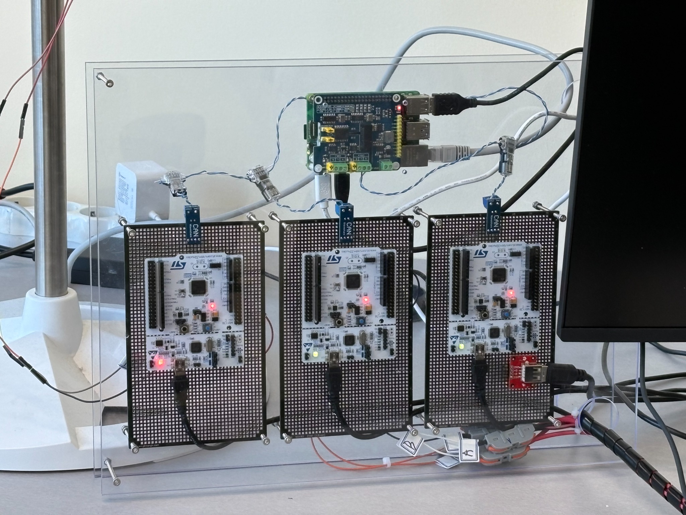 |

- 제어: Raspberry Pi 5 (8GB), STM32 NUCLEO-F446RE ×3
- CAN: Waveshare 2-CH CAN FD HAT, SN65HVD230, Vector VN5620
- 입력: Logitech G29 휠·기어·페달, 페달 내장 Potentiometer
- 촉각: SIMAGIC P-HPR, P2000 Haptic Control Box
- 구동: DC Motor, Motor Driver, Wheel
- 출력: HMI 모니터, JBL PULSE 4

## 4. 위험도 판단 알고리즘

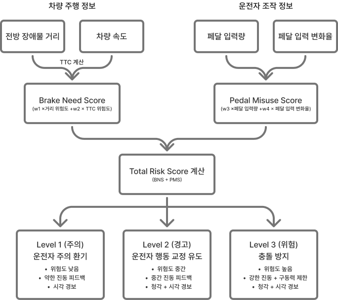


주변 환경에 대한 **제동 필요도(BNS)**와 조작 정보에 대한 **페달 오조작 위험도(PMS)**를 결합합니다.

```text
BNS = w1 × Distance Risk + w2 × TTC Risk
PMS = w3 × Pedal Input  + w4 × Pedal Input Rate
Total Risk Score = BNS + PMS
TTC = Distance / Relative Closing Speed
```

- 장애물 거리, TTC, 페달 조건을 결합해 **Level 0~3** 판단
- 거리·TTC·페달 조건 중 **2개 이상** 충족 시 등급 후보로 판단하는 다중 조건 규칙 적용
- 페달 조건은 입력량 또는 입력 변화율 중 하나를 만족하면 인정
- 등급 상승은 **3회 연속**, 하강은 **5회 연속** 확인하여 급격한 등급 변동 방지
- CARLA 환경에서는 상대 접근속도에 따른 정지거리 기준도 활용

### 위험 등급별 시스템 개입

| 단계 | 상태 | 햅틱 설정 | 운전자 알림 | 구동 제어 |
|---|---|---|---|---|
| **L0** | 정상 | OFF | 정상 상태 표시 | 정상 주행 |
| **L1** | 주의 | 20 Hz / 30% | 시각·청각 주의 경고 | 개입 없음 |
| **L2** | 경고 | 20 Hz / 45% | 강화 경고·행동 교정 유도 | 오조작 의심 시 최고 속도 30 km/h 제한 |
| **L3** | 위험 | 30 Hz / 65% | 긴급 위험 경고 | 구동 출력 차단 |

### 위험 단계별 3D HMI

| Level 0 · 정상 | Level 1 · 주의 |
|:--:|:--:|
| 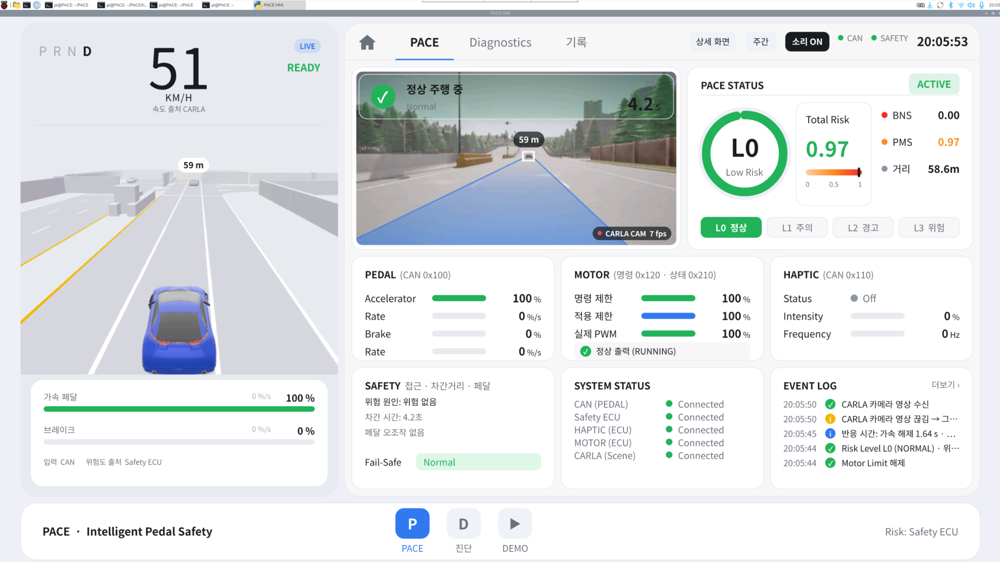 | 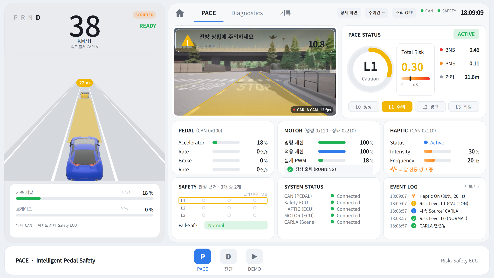 |

| Level 2 · 경고 | Level 3 · 위험 |
|:--:|:--:|
| 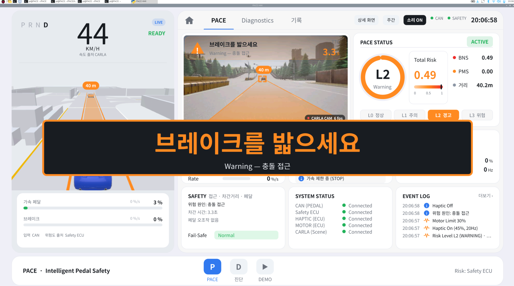 | 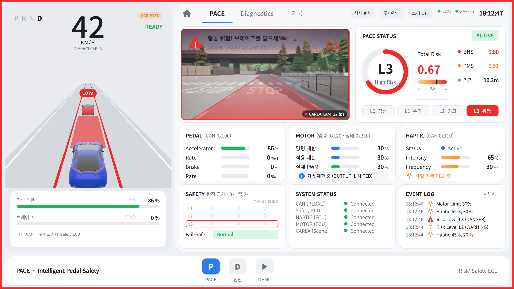 |

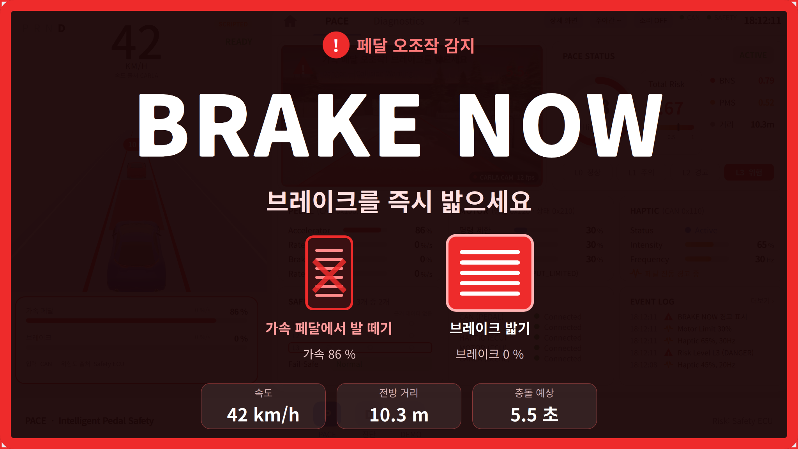

**핵심 설계 의도:** 위험도가 높아질수록 진동 강도를 단계적으로 높여, 차량이 강제로 개입하기 전에 운전자가 가속 페달을 해제하거나 브레이크로 전환하도록 유도합니다.

## 5. CAN 통신 프로토콜

- **Classical CAN 2.0A**, Standard 11-bit ID
- **500 kbps**, **8-byte DLC**, **10 ms 주기**
- **Little Endian**, Byte 7의 8-bit Alive Counter 사용

| CAN ID | Message | 송신 → 수신 | 주요 데이터 |
|---|---|---|---|
| `0x100` | `PEDAL_STATUS` | Pedal → Safety, Motor | 가속·브레이크 입력, 변화율, 센서 상태 |
| `0x110` | `HAPTIC_COMMAND` | Safety → Haptic | Risk Level, 진동 ON/OFF, 세기·주파수 |
| `0x120` | `MOTOR_COMMAND` | Safety → Motor | Normal / Output Limit / Motor Stop, 제한값 |
| `0x200` | `HAPTIC_STATUS` | Haptic → Safety | 햅틱 실행 상태, Fault Code, Timeout |
| `0x210` | `MOTOR_STATUS` | Motor → Safety | 실제 PWM, 출력 제한값, 속도·고장 상태 |

### Fail-Safe

통신 또는 센서 이상이 발생하면 **Timeout / Alive Counter / DLC / 신호 유효성 / 장치 연결 상태**를 검사합니다.

- **안전 정지:** 페달·모터 데이터 오류, CARLA 연결 단절 등 구동 안전에 직접 영향을 주는 고장
- **주행 유지 + 햅틱 차단:** 햅틱 명령·상태 데이터 또는 장치 연결 이상 등 햅틱 계통 고장

CANoe의 DBC·CAPL과 VN5620을 사용해 **15종 고장 주입 및 대응 동작을 검증**했습니다.

## 6. CARLA 및 3D HMI

실제 G29 페달·핸들·기어로 **CARLA 0.9.16**의 가상 차량을 제어합니다. 시뮬레이터는 속도·전방 장애물 거리 등을 Raspberry Pi로 전송하고, Safety ECU가 위험도를 판단합니다.

- 페달 입력 기반 가속·감속, G29 핸들 조향 및 P/R/D 변속
- CARLA ↔ Raspberry Pi 간 **Ethernet / UDP 양방향 통신**
- CARLA 위험 상황을 이용한 반복 검증
- PySide6 / Qt QML 기반 **3D HMI**에서 거리·TTC·차량 속도·페달 입력·BNS·PMS·위험 등급 표시
- 햅틱·모터 개입 상태 및 이벤트·고장 이력 시각화

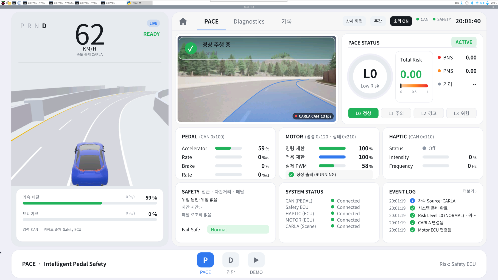

## 7. 개발 과정에서 해결한 문제

| 문제 | 원인 | 해결 |
|---|---|---|
| CAN Form Error | STM32 내부 HSI 클럭의 정확도에 따른 CAN 비트 타이밍 오차 | Pedal·Motor ECU 클럭을 외부 HSE로 변경 후 오류 프레임 0건 확인 |
| 초기 햅틱 모터 전달력 부족 | 소형 진동모터가 페달을 통해 충분한 촉각 피드백을 전달하지 못함 | SIMAGIC P-HPR로 변경 및 USB HID 기반 제어 |
| CARLA 충돌 후 위험도 잔류 | 장애물 미검출 상황에서 거리·TTC 값이 남음 | 장애물 미검출 시 거리·TTC 초기화 처리 |

## 8. 개발 환경

| 영역 | 기술 |
|---|---|
| MCU Firmware | C/C++, STM32CubeIDE |
| Safety ECU | Raspberry Pi OS, Python 3 |
| HMI | PySide6, Qt/QML |
| Simulation | CARLA 0.9.16 |
| CAN Validation | CANoe 18, DBC, CAPL, VN5620 |
| Communication | Classical CAN, Ethernet UDP/TCP, USB, SPI, Bluetooth |
| Version Control | Git, GitHub |

## 9. 시연 영상

[HMI 시연 영상](assets/videos/hmi_demo.mp4) · [CANoe 검증 영상](assets/videos/canoe_validation.mp4) · [행동교정 시뮬레이션](assets/videos/behavior_correction.mp4) · [야간 돌발상황](assets/videos/night_hazard.mov) · [페달 오조작 시뮬레이션](assets/videos/pedal_misuse_simulation.mp4)

**[PACE 최종 시연 동영상 보기 (YouTube)](https://www.youtube.com/watch?v=Ao3brh2CypE)**

시연에서는 **실제 페달 조작 → CARLA 주행 → Safety ECU 위험 판단 → 햅틱 경고·모터 개입 → 3D HMI 상태 표시**의 연결을 확인할 수 있습니다.

## 10. 팀 구성

**Team PACE | 한국공학대학교**

| 팀원 | 담당 |
|---|---|
| 이다은 (팀장) | 시스템 총괄 설계, Safety ECU, BNS·PMS 알고리즘 및 시스템 통합 |
| 권연주 | 3D HMI 개발, CANoe 검증 |
| 곽현민 | Haptic ECU, 위험 단계별 햅틱 제어 |
| 임규민 | Pedal ECU, Motor ECU, CARLA 연동 |

---

<div align="center">

**PACE · Predict Risk, Guide Action, Prevent Accidents**

*위험을 먼저 인지하고, 운전자의 행동 교정을 통해 사고를 예방합니다.*

</div>
